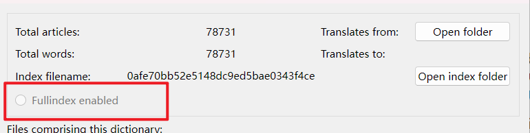

A metadata file, which uses [toml](https://toml.io) format, can be used to customize or override some properties of a certain dictionary. It is also used in [auto grouping by metadata](manage_groups.md)

The metadata file should be placed on each dictionary's root folder (beside dictionary files) and named after the dictionary's id, e.g. `d41d8cd98f00b204e9800998ecf8427e.toml`. The id can be found in the dictionary's info dialog.

```
.
├── Cambridge
│    ├── 3e6c2a2d5f1b4c8e9a7d0f2b6c1e4a8d.toml < here
│    ├── Cambridge.idx
│    ├── Cambridge.info
│    ├── Cambridge.syn
│    └── Cambridge.dict.dz
└── Collins
     ├── 8f14e45fceea167a5a36dedd4bea2543.toml < here
     ├── res.zip
     └── Collins.dsl
```

For backward compatibility, the legacy `metadata.toml` is read when the per-dictionary file does not exist. It is migrated automatically on load by renaming it to the `<dictionary-id>.toml` of the first dictionary in the folder; the other dictionaries in that folder are no longer affected by it. This requires a writable dictionary folder; otherwise `metadata.toml` keeps being read as a fallback.

## Override display name

Some dictionary formats' display is embedded inside the dictionary, which cannot be easily changed, but you can add the following to override it.

```toml
[metadata]
name = "New Name"
```

This `New Name` will be appeared as the dictionary name.

## Disable full-text search

```toml
fts=false

[metadata]
name="New Name"
```

The `fts` field's value can be `on/off`, `1/0` ,`true/false` etc.

```
fts=false
```

will disable the current dictionary's full-text search.

You can check the full-text search status on each dictionary's info dialog.



Note that it is possible to enable full text for a single dictionary by disabling full-text search in the Preferences dialog, and set `fts=true` for that dictionary.
